<div align="center">
  <br />
  
  <h1>🚀 CryptoPulse</h1>
  <p>
    <strong>Real-Time Cryptocurrency Tracker &amp; Simulated Wallet</strong>
  </p>
  <a href="https://cryptopulse-self.vercel.app" target="_blank">
    
  </a>
</div>

---

<div align="center">
  
  
  
  
  
  <br/>
  
  
  
  
  <br/>
  
  
  
  
  <br/>
  
  
  
  
  <br/>
  
  
  
</div>

---

## 📑 Table of Contents

1. [📖 About The Project](#-about-the-project)
2. [🎯 How It Works](#-how-it-works)
3. [🧠 Engineering Decisions](#-engineering-decisions)
4. [🖼️ Screenshots](#️-screenshots)
5. [🧰 Built With](#-built-with)
6. [🚀 Getting Started](#-getting-started)
7. [🗄️ Database Schema](#️-database-schema)
8. [📁 Project Structure](#-project-structure)
9. [📝 License](#-license)
10. [📬 Contact](#-contact)

---

## 📖 About The Project

CryptoPulse is a **real-time cryptocurrency tracker** with a **simulated wallet** — built as a portfolio case study to demonstrate production-grade frontend engineering.

Users can browse live market data for **5,000+ coins**, build a **watchlist**, and **trade with $1,000 in virtual funds**. Every trade is an **atomic Postgres RPC**, every price is **edge-cached**, and every page is designed to feel fast, resilient, and considered.

**What it demonstrates:**

- **Financial precision** — floating-point math that survives the MAX button, dust cleanup, and RPC round-trips.
- **API rate limits** — two-layer caching (Vercel Edge + TanStack Query) on a free tier.
- **Regional access** — an image proxy that serves CoinGecko assets where its CDN is blocked.
- **Data-heavy UIs** — a 5,000-row virtualized table at 60fps.
- **Production resilience** — error boundaries that keep the app usable.
- **Race conditions** — wallet sync that survives rapid user switches and realtime events.

> **The story:** I built this to answer one question: *can a frontend developer ship something that feels like a real product, not a demo?* The UI was accelerated with AI; the core engineering — architecture, state, financial logic, performance — was implemented and reviewed line by line. [Read the full case study →](https://cryptopulse-self.vercel.app/about)

---

## 🎯 How It Works

CryptoPulse has a single user role. The core flow is a full trading cycle: **deposit → buy → watch → sell → withdraw**. Every step is backed by an atomic Postgres RPC.

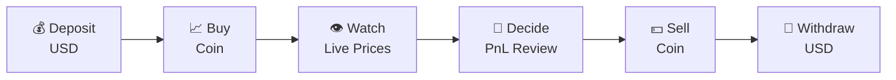

**1. Deposit** — Validated server-side (`$10`–`$100,000`). Logged as a `deposit` transaction.

**2. Buy** — RPC checks cash, deducts `subtotal + fee (0.1%)`, upserts holding with weighted average buy price.

**3. Watch** — Portfolio updates live: total value, allocation, PnL, personal movers.

**4. Decide** — Review daily + all-time PnL, choose to sell, hold, or buy more.

**5. Sell** — RPC checks holding, adds `subtotal − fee (0.1%)` to cash, deletes dust rows (`< 1e-9`).

**6. Withdraw** — Min `$10`. Fee (`$0.50`) deducted from requested amount.

### Safety Guarantees

| Concern | Guarantee |
|---|---|
| **Atomicity** | Every operation runs in a single Postgres transaction (RPC). |
| **Precision** | `numeric` (Postgres) + `EPSILON = 1e-12` (client). |
| **Concurrency** | Row-level locking on `UPDATE` prevents double-spend. |
| **Authorization** | RLS on every table (`auth.uid() = user_id`). |
| **Audit trail** | Every operation logs a `txn_id`. |

---

## 🧠 Engineering Decisions

Seven constraints, seven decisions. Full breakdown on the [About page](https://cryptopulse-self.vercel.app/about).

| # | Challenge | Decision |
|---|---|---|
| 1 | **Financial accuracy** | `EPSILON` tolerance + `floorTo` in `utils/trade.ts`; `numeric` in DB; mirrored formulas. |
| 2 | **Data lifecycle** | Cancelled-flag guards + `loadedUserId` in `useWallet`; realtime debounced 300ms. |
| 3 | **Scalable performance** | TanStack Virtual for rows; `lightweight-charts` (40KB); vendor chunks split. |
| 4 | **API rate limits** | Two-layer cache (Vercel Edge `s-maxage` + TanStack Query); shared `queryKey`s. |
| 5 | **Time constraints** | AI-accelerated UI; human effort on architecture, state, financial logic. |
| 6 | **Regional access** | `api/image.ts` proxies CoinGecko assets with 24h edge cache; `coinImageUrl()` helper. |
| 7 | **Production resilience** | Global `ErrorBoundary` + route `errorElement`; shell stays intact. |

---

## 🖼️ Screenshots

### 🏠 Home

| Desktop | Mobile |
|:---:|:---:|
|  | 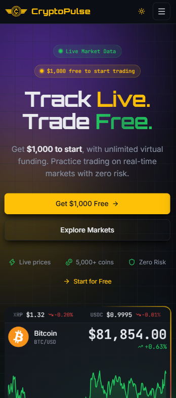 |
| 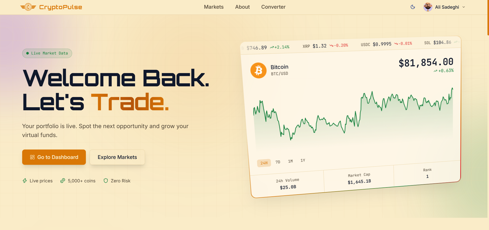 | 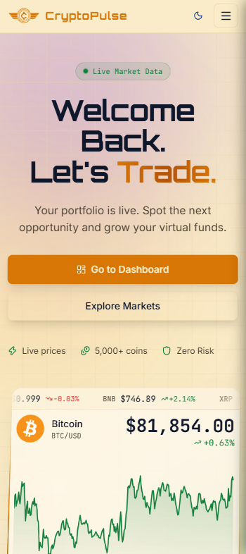 |

### 🪙 Coin Detail

| Desktop | Mobile |
|:---:|:---:|
| 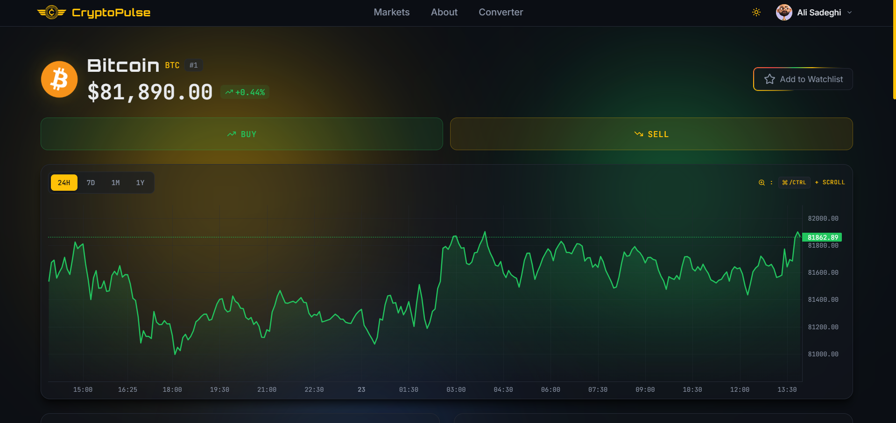 | 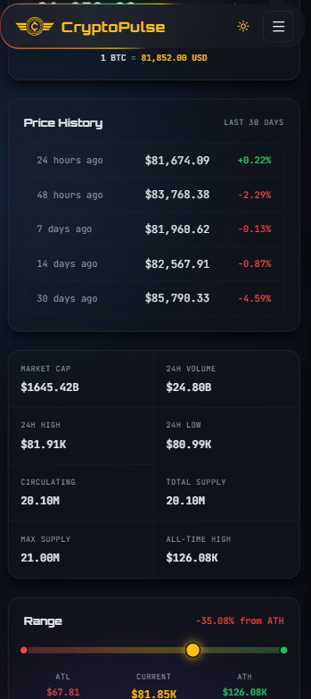 |
| 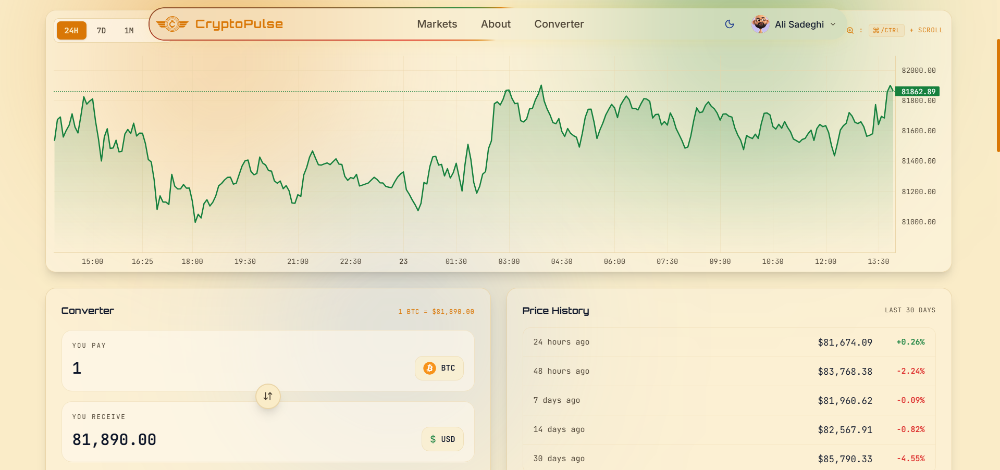 | 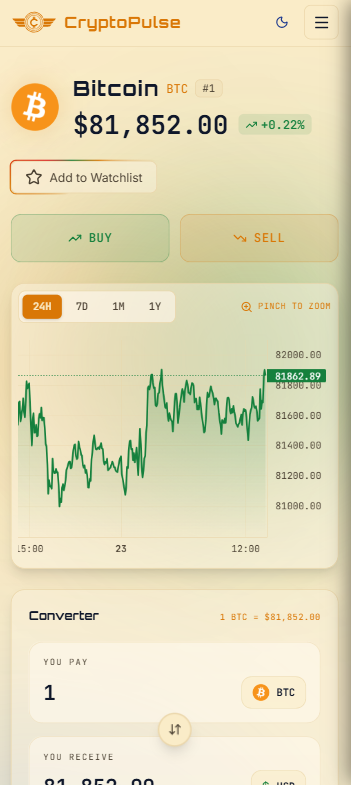 |

### 📈 Markets

| Desktop | Mobile |
|:---:|:---:|
| 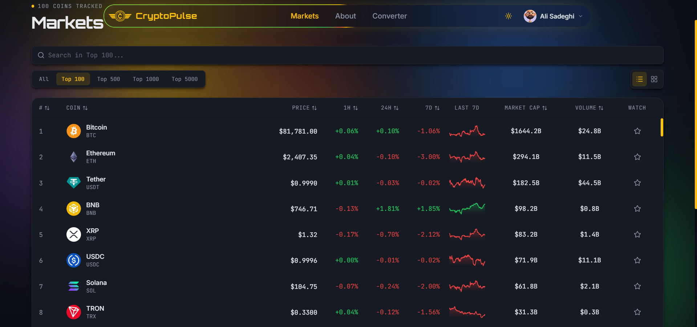 | 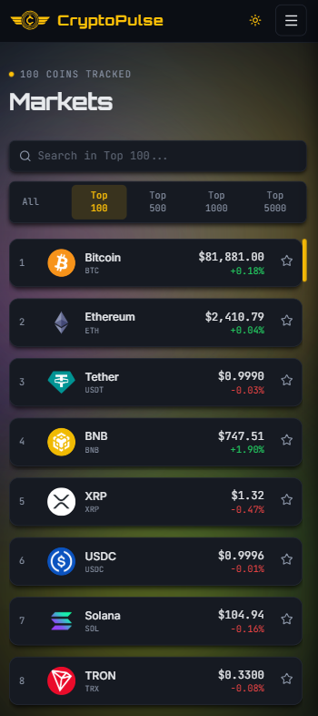 |
| 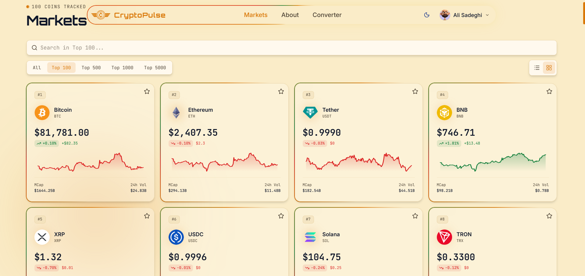 | 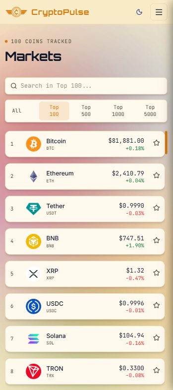 |

### 💰 Wallet

| Desktop | Mobile |
|:---:|:---:|
| 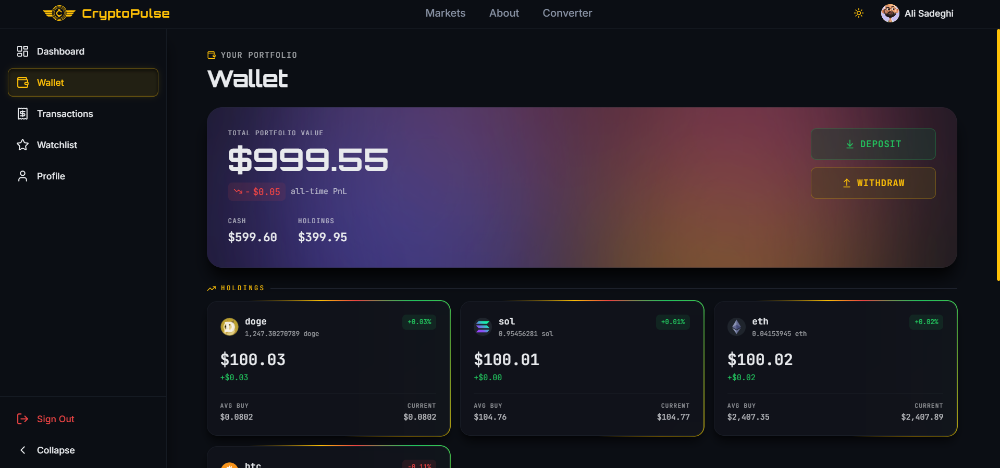 | 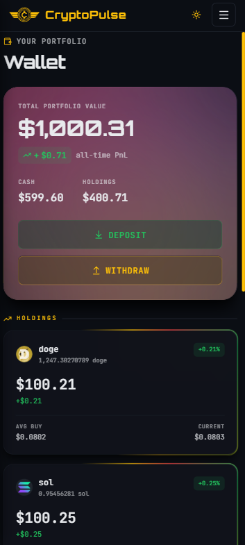 |
| 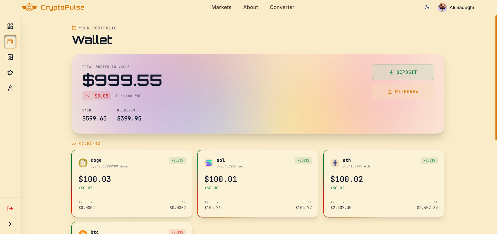 | 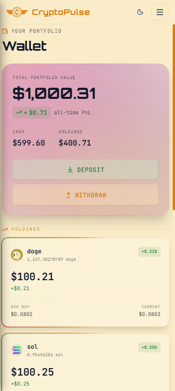 |

> 🌗 Every screen supports Dark & Light mode. Top row: dark. Bottom row: light.

---

## 🧰 Built With

| Category | Technology |
|---|---|
| **Framework** | React 19 + Vite 8 |
| **Language** | TypeScript 6 (strict) |
| **Styling** | Tailwind CSS 4 |
| **State Management** | Zustand 5 + TanStack Query 5 |
| **Routing** | React Router 8 |
| **Database** | Supabase 2 (Postgres + RLS) |
| **Authentication** | Supabase Auth |
| **Validation** | Zod 4 |
| **Forms** | React Hook Form 7 |
| **Data Table** | TanStack Table 8 + TanStack Virtual 3 |
| **Charts** | lightweight-charts 5 |
| **Notifications** | Sonner 2 |
| **Icons** | Lucide |
| **HTTP Client** | Axios 1 |
| **Deploy** | Vercel |

---

## 🚀 Getting Started

### 🛠️ Step 1: Install the Tools You Need

You need **three free tools** installed on your computer:

| Tool | What it does | Download link |
|---|---|---|
| **Node.js** | Runs the website code | [Download Node.js](https://nodejs.org) (choose **LTS**) |
| **pnpm** | Installs project packages | [Download pnpm](https://pnpm.io/installation) |
| **Git** | Downloads the project files | [Download Git](https://git-scm.com/downloads) |

> 🔄 **Important:** After installing, restart your computer.

> 💡 To check if Node is installed, open **Command Prompt** (Windows) or **Terminal** (Mac) and type `node -v`. You should see a version number like `v20.11.0`.

---

### 📁 Step 2: Get the Project Files

Open **Command Prompt** (Windows) or **Terminal** (Mac). Type these commands one by one, pressing **Enter** after each:

```bash
# Download the project
git clone https://github.com/alisadeghi192/cryptopulse.git

# Go inside the project folder
cd cryptopulse

# Install all the pieces the project needs
pnpm install
```

> 💡 `pnpm install` may take 1–2 minutes. Wait for it to finish.

---

### 🗄️ Step 3: Create a Supabase Project

Supabase is the backend that stores users, wallets, and transactions.

1. Go to [supabase.com](https://supabase.com) and sign up (free).
2. Click **"New Project"**.
3. Fill in:
   - **Name:** `cryptopulse`
   - **Database Password:** choose a strong password and **save it somewhere**
   - **Region:** pick the one closest to you
4. Click **"Create new project"** and wait ~2 minutes for setup.

> ✅ You now have a Supabase project. Two things you'll need soon:
> - **Project URL** (Settings → API → Project URL)
> - **Anon Key** (Settings → API → anon public)

---

### 🗃️ Step 4: Set Up the Database

The project needs **4 tables** and **4 SQL functions** (RPCs). All of them are in a single file: **`docs/schema.sql`**.

1. Open your Supabase project → **SQL Editor** (left sidebar).
2. Click **"+ New query"**.
3. In your project folder, open **`docs/schema.sql`** (with Notepad or VS Code).
4. **Copy the entire file** (`Ctrl+A` → `Ctrl+C`).
5. **Paste it** into the SQL Editor.
6. Click **"Run"** (or press `Ctrl + Enter`).

> ✅ You should see **"Success. No rows returned"** — that means everything worked.

**What did it create?**

| Table | What it stores |
|---|---|
| `wallets` | Each user's cash balance |
| `holdings` | Each user's owned coins |
| `transactions` | Every deposit, withdrawal, buy, and sell |
| `watchlist` | Coins each user is watching |

Plus **4 SQL functions** that safely move money and coins in one step:

| Function | What it does |
|---|---|
| `deposit_funds(amount)` | Adds USD to the wallet |
| `withdraw_funds(amount)` | Removes USD from the wallet |
| `buy_coin(...)` | Buys a coin, updates cash + holdings |
| `sell_coin(...)` | Sells a coin, updates cash + holdings |

And **12 RLS policies** that ensure each user can only read and write their own data.

> 🔍 **Verify it worked:** In Supabase, go to **Table Editor** — you should see 4 tables (`wallets`, `holdings`, `transactions`, `watchlist`).

---

### 🔑 Step 5: Get a CoinGecko API Key

CoinGecko provides the live crypto prices. It's free.

1. Go to [coingecko.com/en/developers/dashboard](https://www.coingecko.com/en/developers/dashboard).
2. Sign up (free).
3. Click **"Add New Key"** → **"Demo"**.
4. Copy the key (looks like `CG-xxxxxxxxxxxxxxxx`).

> 💡 The free tier allows ~30 requests per minute — more than enough for local testing.

---

### ⚙️ Step 6: Configure Environment Variables

The project needs to know your Supabase and CoinGecko keys.

1. In the project folder, find the file **`.env.example`**.
2. Make a **copy** and rename it to **`.env.local`** (delete the `.example` part).
3. Open `.env.local` with Notepad (or VS Code). You'll see:

    ```env
    VITE_SUPABASE_URL=
    VITE_SUPABASE_ANON_KEY=
    COINGECKO_API_KEY=
    ```

4. Fill in the values from Steps 3 and 5:

    ```env
    VITE_SUPABASE_URL=https://xxxxxxxxxxxx.supabase.co
    VITE_SUPABASE_ANON_KEY=eyJhbGciOiJIUzI1NiIsInR5cCI6...
    COINGECKO_API_KEY=CG-xxxxxxxxxxxxxxxx
    ```

> 🔒 `.env.local` is in `.gitignore` — it won't be uploaded to GitHub.

---

### 🚀 Step 7: Start the Website!

In your terminal (still inside the project folder), run:

```bash
pnpm dev
```

After a few seconds, you'll see:

```
VITE v8.3.0  ready in 500 ms
➜  Local:   http://localhost:5173/
```

Open your browser and go to **http://localhost:5173**.

The app should appear, with live crypto prices! 🎉

---

### 🛑 Stopping the Website

When you're done, go back to the terminal and press **`Ctrl + C`**.

---

### ❓ Something Went Wrong?

| Problem | Fix |
|---|---|
| `node: command not found` | Node.js is not installed. Go back to Step 1. |
| `pnpm: command not found` | Install pnpm: `npm install -g pnpm`. |
| `Missing Supabase environment variables` | Check `.env.local` — the URL and anon key must be filled. |
| Coin images don't load | You're in a region where CoinGecko's CDN is blocked. The app has a proxy — wait 10 seconds and refresh. |
| Database error when signing up | Step 4 (SQL script) didn't run. Go back and run it. |
| `pnpm dev` shows an error | Delete `node_modules` and run `pnpm install` again. |

> 💡 If you're stuck, paste the error message into an AI assistant (ChatGPT, Claude, etc.) — they can usually spot the issue instantly.

---

## 🗄️ Database Schema

Four tables, all with RLS (`auth.uid() = user_id`):

| Table | Columns |
|---|---|
| **`wallets`** | `user_id` (PK), `cash_balance`, `account_number`, `created_at` |
| **`holdings`** | `id` (PK), `user_id`, `coin_id`, `coin_symbol`, `amount`, `avg_buy_price`, `created_at` |
| **`transactions`** | `id` (PK), `user_id`, `type`, `coin_id`, `coin_symbol`, `amount`, `price`, `fee`, `txn_id`, `total_usd`, `created_at` |
| **`watchlist`** | `id` (PK), `user_id`, `coin_id`, `created_at` |

Four RPCs (all atomic):

- **`deposit_funds(p_amount)`** — adds to cash, logs a `deposit` transaction.
- **`withdraw_funds(p_amount)`** — validates min `$10`, deducts cash, logs a `withdraw` transaction.
- **`buy_coin(p_coin_id, p_coin_symbol, p_coin_amount, p_price, p_fee_rate)`** — checks cash, deducts subtotal + fee, upserts holding with weighted average buy price.
- **`sell_coin(p_coin_id, p_coin_symbol, p_coin_amount, p_price, p_fee_rate)`** — checks holding, adds subtotal − fee to cash, deletes dust rows.

Full SQL in [`docs/schema.sql`](./docs/schema.sql).

---


## 📁 Project Structure

```
cryptopulse/
├── api/                              # Vercel serverless functions
│   ├── coingecko.ts                  # CoinGecko API proxy (edge cache + API key)
│   └── image.ts                      # CoinGecko image proxy (regional access)
│
├── docs/                             # Documentation
│   └── schema.sql                    # Full DB schema (tables + RPCs + RLS + grants)
│
├── public/                           # Static assets
│   ├── og-image.png                  # Open Graph image (1200×630)
│   ├── favicon.svg                   # Favicon
│   ├── ali.webp                      # Developer avatar
│   ├── auth1.webp                    # Auth panel image (login)
│   ├── auth2.webp                    # Auth panel image (register)
│   └── tech/                         # Tech stack icons (SVG)
│
├── screenshots/                      # README screenshots
│   ├── home-desktop.png
│   ├── home-mobile.png
│   ├── markets-desktop.png
│   ├── coin-mobile.png
│   └── ...
│
├── src/
│   ├── App.tsx                       # Router provider
│   ├── main.tsx                      # App entry (initializers + providers)
│   ├── index.css                     # Tailwind + theme + keyframes
│   ├── vite-env.d.ts                 # Vite env types
│   │
│   ├── components/
│   │   ├── layout/                   # TopBar, Sidebar, Footer, MobileNavDrawer
│   │   ├── providers/                # Auth, Wallet, Watchlist, Theme initializers
│   │   └── ui/                       # AnimatedModal, Button, Charts, DataTable, etc.
│   │
│   ├── constants/                    # Fees, about content, ambient lights, etc.
│   │   ├── about.ts
│   │   ├── ambient.ts
│   │   ├── fees.ts
│   │   ├── footer.ts
│   │   ├── header.ts
│   │   ├── transactions.ts
│   │   ├── ui.ts
│   │   ├── zIndex.ts
│   │   └── index.ts
│   │
│   ├── features/                     # Feature-based modules
│   │   ├── about/                    # About page sections
│   │   ├── auth/                     # Login, Register, schemas
│   │   ├── coin/                     # Coin detail, TradeModal
│   │   ├── converter/                # Converter, CurrencySelect
│   │   ├── dashboard/                # Allocation, Movers, QuickActions
│   │   ├── home/                     # Hero, LivePulse, TrendingCoins
│   │   ├── markets/                  # Markets table, filters, grid
│   │   ├── profile/                  # Profile, Security, Avatar
│   │   ├── transactions/             # Transactions list, filters, modal
│   │   └── wallet/                   # Portfolio, Holdings, Deposit/Withdraw
│   │
│   ├── hooks/                        # useWallet, useCoins, useCoinImages, etc.
│   │
│   ├── layouts/                      # RootLayout, AppLayout, AuthLayout
│   │
│   ├── lib/                          # API clients, query client, Supabase, utils
│   │   ├── api/
│   │   ├── axios.ts
│   │   ├── confirm.tsx
│   │   ├── fonts.ts
│   │   ├── queryClient.ts
│   │   └── supabase.ts
│   │
│   ├── pages/                        # Route components
│   │   ├── Home.tsx
│   │   ├── Markets.tsx
│   │   ├── CoinDetail.tsx
│   │   ├── Converter.tsx
│   │   ├── About.tsx
│   │   ├── Auth.tsx
│   │   ├── Dashboard.tsx
│   │   ├── Wallet.tsx
│   │   ├── Transactions.tsx
│   │   ├── Watchlist.tsx
│   │   ├── Profile.tsx
│   │   └── NotFound.tsx
│   │
│   ├── routes/                       # Router config
│   │   └── index.tsx
│   │
│   ├── stores/                       # Zustand stores
│   │   ├── useAuthStore.ts
│   │   ├── useThemeStore.ts
│   │   ├── useWalletStore.ts
│   │   └── useWatchlistStore.ts
│   │
│   ├── types/                        # TypeScript types
│   │   ├── coin.ts
│   │   └── wallet.ts
│   │
│   └── utils/                        # cn, format, trade, image
│       ├── cn.ts
│       ├── format.ts
│       ├── image.ts
│       └── trade.ts
│
├── .env.example                      # Environment variables example
├── .gitignore                        # Git ignore (node_modules, dist, .env.local)
├── .prettierrc                       # Prettier config
├── eslint.config.js                  # ESLint config
├── index.html                        # HTML entry
├── package.json
├── pnpm-lock.yaml
├── README.md                         # 👋 Hello You are here now
├── tsconfig.json
├── tsconfig.app.json
├── tsconfig.node.json
├── vercel.json                       # SPA rewrites + API routes
└── vite.config.ts                    # Vite config (alias, proxy, chunks)
```

---

## 📝 License

This project is created for educational and portfolio purposes.
You are free to use, modify, and learn from it, **provided that proper credit is given to the original author**.

---

## 📬 Contact

**Ali Sadeghi**  
📧 [aliisadeghii192@gmail.com](mailto:aliisadeghii192@gmail.com)  
📱 [+98 991 20 32 109](tel:+989912032109)  
💬 [Telegram (prefer)](https://t.me/alisadeghi_dev) <br>
📷 [Instagram](https://instagram.com/alisadeghi_dev)  
🔗 [GitHub](https://github.com/alisadeghi192) <br>
🔗 [LinkedIn](https://www.linkedin.com/in/alisadeghi19211/)

---

<div align="center">
  <sub>Made with ❤️ and lots of code</sub>
</div>