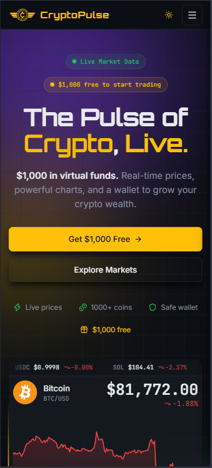
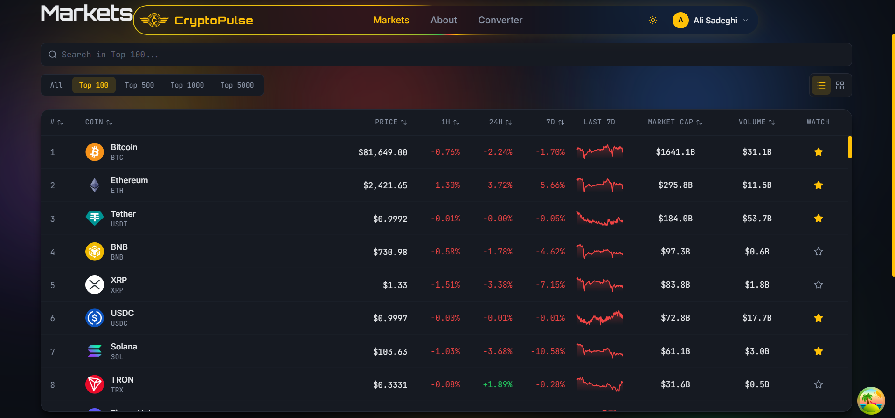
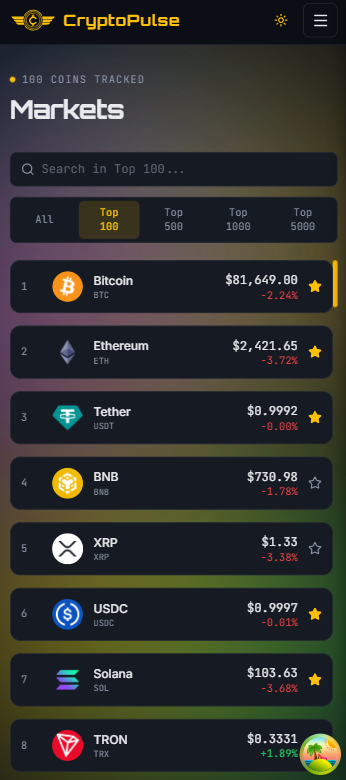
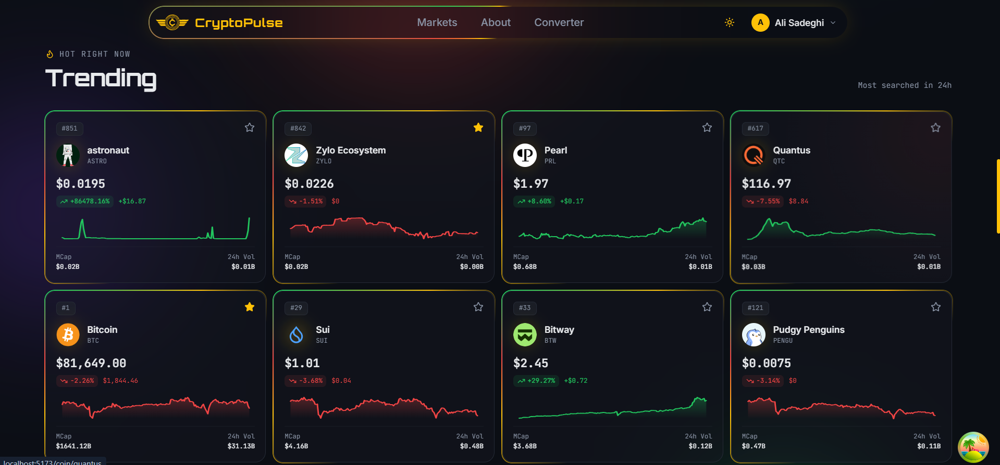
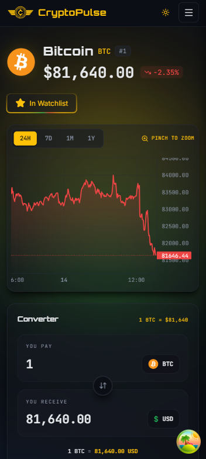
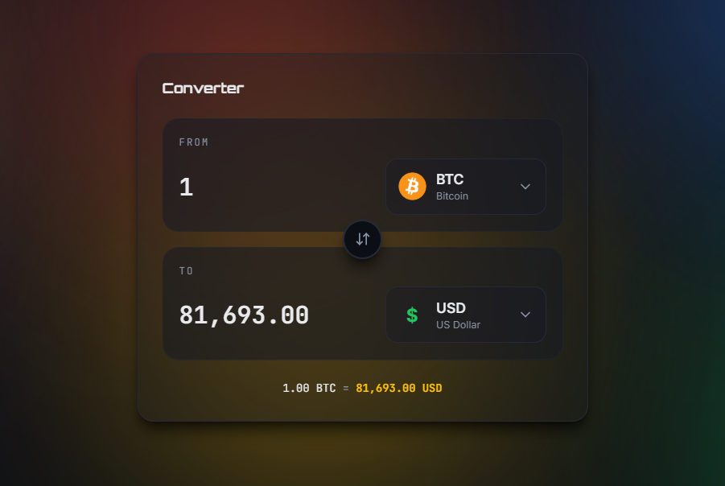

# CryptoPulse 🚀

A modern cryptocurrency tracking platform built with React, TypeScript, and Supabase.

## 📸 UI Preview

A glimpse of the interface — some screenshots from the current build:

### Home

### Markets

### Trending

### Coin Detail

### Converter

### Auth

## 🚧 Coming Soon

Full documentation, setup guide, and architecture notes will be published soon.

---

## 🛠️ Tech Stack

- **React 19** + **TypeScript**
- **Vite** — Build tool
- **Tailwind CSS 4** — Styling
- **TanStack Query** — Server state management
- **TanStack Table** + **TanStack Virtual** — Data table with virtualization
- **Zustand** — Client state management
- **React Router** — Routing
- **Supabase** — Auth + Database
- **ECharts** — Charts
- **Sonner** — Notifications
- **Axios** — HTTP client